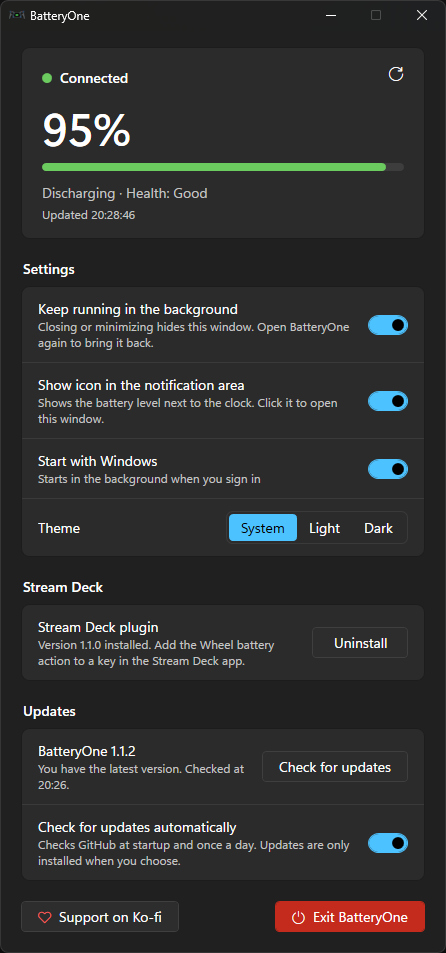

# BatteryOne

> [!NOTE]
> This project was built with the help of AI ([Claude](https://claude.ai) by Anthropic). It has been fully tested on real hardware: a Heusinkveld One steering wheel and an Elgato Stream Deck.

A small Windows app that shows the battery level of the **Heusinkveld One steering wheel**, so you don't have to keep SmartControl open.



## Features

- Shows whether the wheel is **connected**, its **battery percentage**, whether it is charging, and the battery health
- **Charging mode**: while the wheel is on the charger (it does not send inputs then) the app, tray icon and Stream Deck key turn blue, with the time until full
- Shows **OFF** when the wheel is switched off or out of range, or when the USB dongle is not plugged in
- Optional **notification-area (tray) icon** with the percentage, coloured green / orange / red, and a notification when the battery gets low
- Optional **Start with Windows**: starts in the background when you sign in
- **Light and dark mode**: follows the Windows setting, or choose one
- **Stream Deck plugin**: shows the same icon on a Stream Deck key. Press the key to refresh.
- **Built-in updater** for the app and the Stream Deck plugin
- A single small `.exe` with no installer. It only reads the battery level and never changes any wheel settings.

## Requirements

- Windows 10 or 11
- A Heusinkveld One steering wheel paired with its USB dongle

SmartControl does **not** need to be running, or even installed. You still need it for pairing, firmware updates and configuration. BatteryOne can run at the same time as SmartControl.

## Installation

1. Download `BatteryOne.exe` from the [latest release](https://github.com/Jaizu/BatteryOne/releases/latest), or [build it yourself](#building).
2. Put it in any folder, for example `Documents\SimRacing\BatteryOne`.
3. Double-click it. To get a desktop shortcut, right-click the exe → **Send to** → **Desktop (create shortcut)**.

Windows SmartScreen may warn you the first time because the exe is not signed. Click **More info** → **Run anyway**.

## Usage

| Setting | What it does |
| --- | --- |
| **Keep running in the background** | Closing or minimizing the window hides it, including from the taskbar, and BatteryOne keeps running. When it is off, closing the window exits BatteryOne. |
| **Show icon in the notification area** | Shows the battery percentage next to the clock. Click the icon to open the window, or right-click it for **Refresh now** and **Exit**. |
| **Start with Windows** | Starts BatteryOne in the background when you sign in. |
| **Theme** | **System** follows the Windows light/dark setting; **Light** and **Dark** force one. |
| **Stream Deck plugin** | Installs or removes the [Stream Deck plugin](#stream-deck-plugin). Only shown when the Stream Deck app is installed. |

**Opening the window again:** start BatteryOne again (desktop shortcut, Start menu, or the exe). Only one BatteryOne runs at a time, so this brings the running one to the front instead of starting a second copy. Clicking the tray icon also works when it is shown.

**Exiting:** click the red **Exit BatteryOne** button, or **Exit** in the tray icon menu. If the Stream Deck plugin is installed, BatteryOne first warns that the Stream Deck key stops updating while it is closed. Tick **Don't show this again** to skip the warning next time.

Tray icon colours:

| Icon | Meaning |
| --- | --- |
| Green | Above 50 % |
| Orange | 50 % or less |
| Red | 20 % or less. A notification appears once. |
| Grey `OFF` | Wheel off or out of range, or the dongle is not plugged in |

The battery level refreshes every 60 seconds, or when you click the refresh button.

## Stream Deck plugin

The plugin puts the BatteryOne icon on a Stream Deck key: the same colours, the percentage, and **OFF** when the wheel is not connected.


**Install:** in BatteryOne, click **Install** under **Stream Deck**, then click **Install** in the dialog that the Stream Deck app shows. The plugin is built into `BatteryOne.exe`, so there is nothing else to download. Alternatively, download `BatteryOne.streamDeckPlugin` from the [latest release](https://github.com/Jaizu/BatteryOne/releases/latest) and double-click it.

**Update:** when a newer plugin version is available, BatteryOne shows an **Update** button next to **Uninstall**.

Then, in the Stream Deck app, drag **BatteryOne → Wheel battery** onto a key.

**Uninstall:** click **Uninstall** in BatteryOne. Stream Deck has no uninstall command, so BatteryOne closes the Stream Deck app, removes the plugin and starts the app again.

**How it behaves:**

- The plugin gets its data from BatteryOne, so **BatteryOne must be running**. Turning on its **Start with Windows** setting is the easiest way. Neither the window nor the tray icon has to be shown.
- BatteryOne reads the wheel every 60 seconds. The key follows it within 5 seconds, so the key and the tray icon always match.
- **Pressing the key** makes BatteryOne read the wheel right away. While it reads, the key shows `…`.
- If BatteryOne is not running, the key shows **BatteryOne closed**. Pressing it starts BatteryOne in the background, if it has been run at least once on this PC.

Requires Stream Deck 6.0 or later on Windows.

## Updates

BatteryOne and the Stream Deck plugin have their own version numbers. You can see both in the window: under **Updates** for the app, and under **Stream Deck** for the plugin.

- With **Check for updates automatically** on, BatteryOne checks [GitHub](https://github.com/Jaizu/BatteryOne/releases) at startup and once a day. If the tray icon is shown, it also tells you there when a new version is out. Nothing is installed until you choose to.
- **Check for updates** checks right away.
- **Update** downloads the new `BatteryOne.exe`, checks its SHA-256 checksum, replaces the current exe, and restarts BatteryOne. Your settings are kept.
- If the Stream Deck plugin is installed and a newer version is available, an **Update** button appears next to it.

If BatteryOne is in a folder it cannot write to (for example `C:\Program Files`), the update opens the release page instead so you can download it yourself.

### Advanced settings

Settings are saved in `%APPDATA%\BatteryOne\settings.ini`. Besides the options in the window, you can edit:

| Key | Default | Description |
| --- | --- | --- |
| `RefreshSeconds` | `60` | How often the battery level is read (5 to 3600) |
| `LowThreshold` | `20` | Percentage at which the icon turns red and the low-battery notification appears |

Restart BatteryOne after editing the file.

If BatteryOne ever crashes, the details are written to `%APPDATA%\BatteryOne\error.log`.

### Uninstalling

Uninstall the Stream Deck plugin if you installed it, turn off **Start with Windows**, exit BatteryOne, and delete the exe and the `%APPDATA%\BatteryOne` folder.

## How it works

The wheel talks to the PC through its USB dongle (USB vendor ID `0x30B7`, product ID `0x1008`), which appears in Windows as a HID game controller. BatteryOne sends the same battery request that SmartControl uses, through the Windows HID API (`hid.dll`). No drivers or third-party libraries are involved.

1. Find the dongle's HID interface that accepts 64-byte feature reports.
2. Send feature report `05 A0 03`: report 5 (device TX), `0x20` (steering-wheel group) with the request flag `0x80`, and `0x03` (battery info).
3. Wait up to 2 seconds for input report `06 20 03` and read it:

   | Byte | Content |
   | --- | --- |
   | 3 | USB cable status (1 = on the charger) |
   | 4 | Battery percentage |
   | 5–8 | Remaining time in seconds (uint32, `0xFFFFFFFF` = unknown) |
   | 9 | Status: 0 unknown, 1 charging, 2 discharging, 3 not charging, 4 full |
   | 10 | Health: 0 unknown, 1 good, 2 overheat, … |

If the dongle is not found, or the wheel does not answer in time, BatteryOne shows **Not connected / OFF**.

### Reading the battery level from other programs

While it runs, BatteryOne answers on the named pipe `\\.\pipe\BatteryOne`. Connect, send one line, and read one line of JSON back:

| Command | Answer |
| --- | --- |
| `status` | The last reading |
| `refresh` | Reads the wheel now, then answers |

```json
{"state":"connected","refreshing":false,"lowThreshold":20,"percent":88,"charging":false,"status":"Discharging","health":"Good","detail":"Discharging · Health: Good","updated":"2026-10-17T16:30:52"}
```

`state` is one of `checking`, `connected`, `wheelOff`, `dongleNotFound` or `error`. `charging` is true while the wheel is on the charger; `state` stays `connected` then. Quick test from PowerShell:

```powershell
$p = New-Object IO.Pipes.NamedPipeClientStream('.', 'BatteryOne', 'InOut'); $p.Connect(1000)
$w = New-Object IO.StreamWriter($p); $w.AutoFlush = $true; $w.WriteLine('status')
(New-Object IO.StreamReader($p)).ReadLine(); $p.Dispose()
```

BatteryOne also writes the path of its exe to `%APPDATA%\BatteryOne\app-path.txt`, so other programs can start it.

## Building

You need the [.NET SDK](https://dotnet.microsoft.com/download) (6 or later). The app targets .NET Framework 4.8, which is included in Windows 10 and 11, so the resulting exe runs without installing any runtime.

```powershell
dotnet build -c Release
```

The exe is written to `bin\Release\net48\BatteryOne.exe`. The build also compiles the Stream Deck plugin and embeds it in the exe, so the **Install** button can install it.

### Versions and releases

Both version numbers live in [`Directory.Build.props`](Directory.Build.props):

| Property | Used for |
| --- | --- |
| `AppVersion` | `BatteryOne.exe` and the release tag (`v1.0.0`) |
| `PluginVersion` | The Stream Deck plugin (the exe and its `manifest.json`). Only bump it when the plugin changes. |

To make a release:

1. Bump the versions in `Directory.Build.props`.
2. Run:

   ```powershell
   powershell -ExecutionPolicy Bypass -File tools\build-release.ps1
   ```

   This puts `BatteryOne.exe`, `BatteryOne.streamDeckPlugin` and `versions.json` in `dist\release`.
3. Create a GitHub release tagged `v<AppVersion>` and upload those three files. The updater uses `versions.json` and the file names, so keep them as they are.

### Source files

| Path | Content |
| --- | --- |
| `src/App.cs` | Startup, single instance, refresh timer |
| `src/MainWindow.xaml` | The main window |
| `src/Dialog.xaml` | Confirmation dialog |
| `src/Styles.xaml` | Windows 11 style controls (switches, buttons, check box) |
| `src/StreamDeckPlugin.cs` | Installs, updates and removes the Stream Deck plugin |
| `src/Updater.cs` | Version numbers, update check and self-update |
| `src/WheelBattery.cs` | Battery request and reply parsing |
| `src/Hid.cs` | Minimal HID access through `hid.dll` / `setupapi.dll` |
| `src/TrayIcon.cs` | Notification-area icon |
| `src/Theme.cs` | Light/dark palette and title bar |
| `src/Settings.cs` | Settings file and Start with Windows |
| `src/BatteryIcon.cs` | Draws the battery icon (shared by the tray icon and the Stream Deck plugin) |
| `src/PipeServer.cs` | Named pipe that other programs read the battery level from |
| `streamdeck/src/Plugin.cs` | Stream Deck plugin: talks to the Stream Deck app and updates the key |
| `streamdeck/src/BatteryOneClient.cs` | Reads the battery level from BatteryOne's pipe |
| `streamdeck/com.batteryone.wheel.sdPlugin/` | Plugin manifest and images |
| `tools/make-icon.ps1` | Regenerates `Assets/BatteryOne.ico` |
| `tools/make-streamdeck-images.ps1` | Regenerates the Stream Deck plugin images |
| `tools/build-release.ps1` | Builds the files for a GitHub release |

## License

[MIT](LICENSE). You can use, copy, modify and share it freely.

## Disclaimer

This is an unofficial tool, not affiliated with or endorsed by Heusinkveld Engineering. The protocol was worked out by inspecting how SmartControl talks to the wheel, and a future firmware update could change it.
